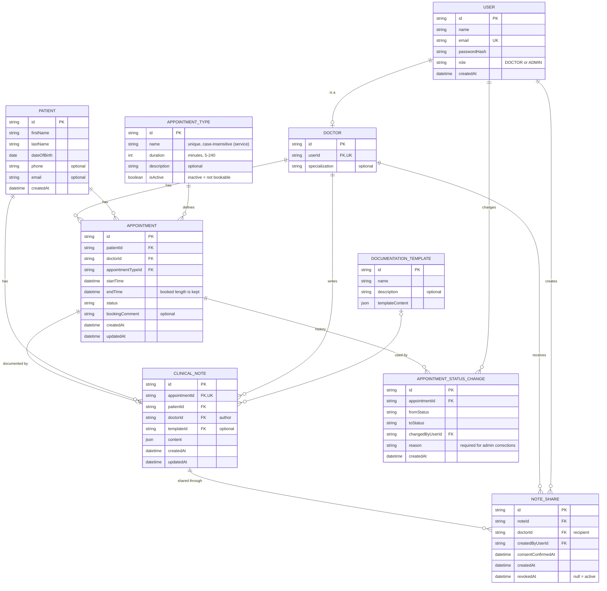

# ER diagram – Puls

Reflects `backend/prisma/schema.prisma` as of week 12.

## Notes

- `USER ||--o| DOCTOR`: one-to-one, optional. Only users with role Doctor have
  a Doctor row. Admin users have no Doctor row.
- `APPOINTMENT ||--o| CLINICAL_NOTE`: one-to-one, optional. One note per
  appointment (`appointmentId` is unique on `CLINICAL_NOTE`).
- `DOCUMENTATION_TEMPLATE |o--o{ CLINICAL_NOTE`: a note has zero or one
  template. The template is chosen when the note is created and cannot be
  changed afterwards.
- `CLINICAL_NOTE.content` and `DOCUMENTATION_TEMPLATE.templateContent` are
  stored as JSON rather than separate tables, to keep templates simple.
- `APPOINTMENT.status` is an enum: SCHEDULED, CONFIRMED, COMPLETED, CANCELLED,
  NO_SHOW.
- Nothing that carries history is deleted:
  - Cancelling an appointment is a status change (`CANCELLED`).
  - Retiring an appointment type sets `isActive = false`.
  - Revoking a note share sets `revokedAt`; sharing again creates a new row.
  - Every status change is written to `APPOINTMENT_STATUS_CHANGE`; corrections
    by an admin need a reason. The table is only appended to.
- `NOTE_SHARE` gives a doctor read access to another doctor's note. The
  recipient (`doctorId`) and the creator (`createdByUserId`, a user) are
  separate so that a future patient login could create shares without
  changing the table. There is no unique index on `(noteId, doctorId)`: only
  one active share per pair is allowed, and that is checked in the service.
- `APPOINTMENT.endTime` is stored, not calculated, so changing a type's
  duration does not change booked appointments.
